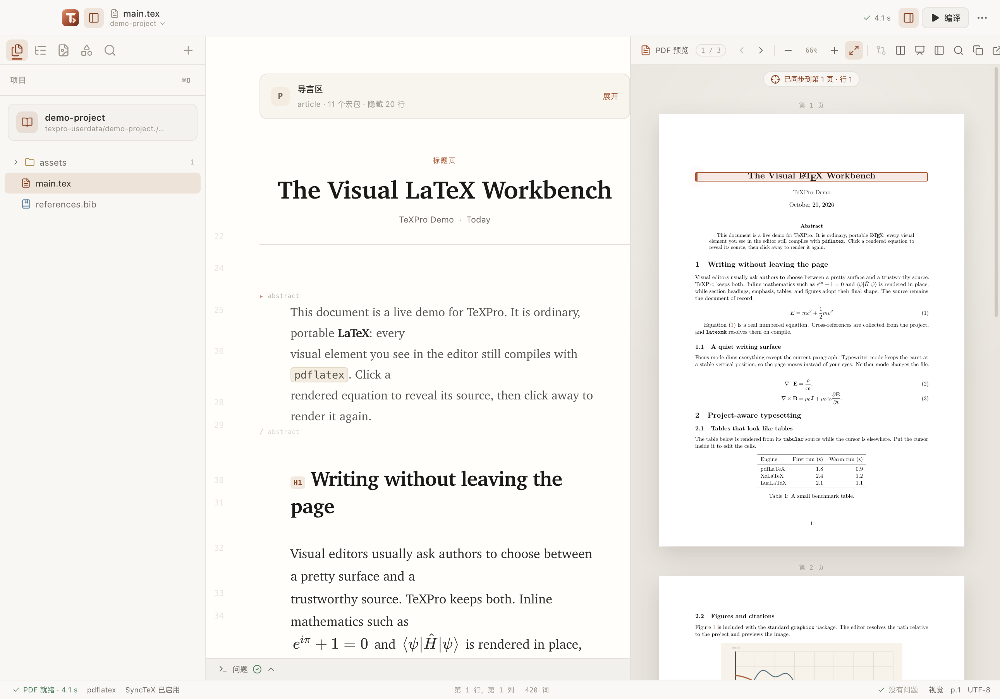

# TeXPro

[简体中文](README.md) · **English**

A writing-first LaTeX desktop editor. Ordinary `.tex` files remain the originals; inline previews, project management, local compilation and PDF navigation all work with the same source.



[User guide](https://texpro.pyliubaolin.top/docs) · [Developer docs](https://texpro.pyliubaolin.top/developers) · [Downloads and releases](https://github.com/lzhbhlrPython/TexPro/releases) · [Repository guides](docs/README.md) · [Collaboration rules](AGENTS.md)

## Writing and projects

The first stable release is **v0.1.0 · Tajpilo** (2026-11-12). The **0.1.x** series uses **Tajpilo**, Esperanto for “typewriter”, as its codename. See the [release notes](docs/releases/v0.1.0.md) and [stable releases](https://texpro.pyliubaolin.top/releases).

- Inline previews for equations, headings, simple tables, illustrations, TikZ and music. Edit the source at any time; use optional tools for complex content.
- Markdown-style input shortcuts and paste conversion, while preserving direct TeX input and undo.
- Placeholders for unfinished content and source comments for revision notes. Reopen a project with its files and writing position restored.
- Project trees, modules, assets, bibliography, templates, labels and references, with one explicit compilation root.
- Local latexmk, multiple TeX engines, diagnostics, PDF reading and bidirectional SyncTeX navigation.
- **Realtime TeX preview:** LuaLaTeX projects automatically use the bundled rtex-ts in the existing PDF area, following automatic compilation settings. There is no separate engine switch or mode. PDF operations prepare a full typeset result when needed; typing continues to update the preview. A local LuaLaTeX installation is required. See the [embedding guide](docs/realtime-tex.md) for sources, MIT distribution and limitations.
- Optional history, Git, backups, LAN collaboration, AI and MCP. Review permissions and data flow before enabling network features.

Complex TeX may fall back to source editing. SyncTeX maps typeset content rather than arbitrary individual characters, and visual previews do not replace the final PDF. Optional workspaces should not be prerequisites for ordinary writing. See [PRODUCT.md](PRODUCT.md) for product principles.

## Install and run

Use `package.json`, lockfiles and workflows as the authority for development and CI tool versions. CI uses Node.js 22. Actual compilation requires `latexmk`, the selected engine and `synctex` from TeX Live or MacTeX.

```sh
npm ci
npm run dev
```

Build and launch the production interface:

```sh
npm run build
npm start
```

Restart the development process after changing Electron services. The interface can build without TeX, but compilation will be unavailable. An application installer does not replace a local TeX distribution. Check the corresponding Release for signing status and platform validation.

## Project root file

When a project opens, `.texpro/project.json.rootFile` takes priority. Without that setting, TeXPro accepts only one unambiguous, uncommented `\documentclass` candidate. Multiple candidates require a choice; invalid configuration produces an explicit error. The active tab does not silently change the compilation root. Related unsaved buffers are saved before compilation.

See [Projects and files](https://texpro.pyliubaolin.top/docs/project), [Compilation](https://texpro.pyliubaolin.top/docs/compile) and [Writing aids](https://texpro.pyliubaolin.top/docs/writing-aids) for instructions.

## Development documentation

The website provides Chinese and English task guides. Repository maintenance guides linked below are primarily in Simplified Chinese; product principles and package READMEs also have English content.

| Entry | Contents |
| --- | --- |
| [Documentation index](docs/README.md) | Reading order and topic guides |
| [AGENTS.md](AGENTS.md) | Application, website, documentation, Git and release constraints |
| [DESIGN.md](DESIGN.md) | Paper design language and tokens, organized in the Google DESIGN.md format |
| [Development guide](docs/development.md) | Environment, source navigation, checks and handoff |
| [Architecture](docs/architecture.md) | Module responsibilities and major flows |
| [Technical contracts](docs/technical-contracts.md) | Saving, root files, async results, previews, IPC and shutdown invariants |
| [Documentation maintenance](docs/documentation.md) | Bilingual website content, document roles and generated outputs |
| [MCP](mcp/README.md) | External stdio service and tools |

## Verification

```sh
npm run typecheck
npm run test:regression
npm run build
npm run verify:release
```

Add actual compilation, MCP and native interaction checks as appropriate; see the [validation matrix](docs/development.md). The complete baseline must have zero failures, skips and TODOs. Report the checks actually run and the platform used; a fixed test count is not evidence of the current result.

## Website

The independent website lives in `product-page/`, uses pnpm and is excluded from Electron packaging.

```sh
cd product-page
pnpm install --frozen-lockfile
pnpm dev
```

See the [website README](product-page/README.md) and [Pages deployment guide](docs/product-page-deployment.md). The [User guide](https://texpro.pyliubaolin.top/docs) covers everyday writing; [Developer docs](https://texpro.pyliubaolin.top/developers) cover extensions, MCP and application development. Both maintain Chinese and English content; the development blog retains its Simplified Chinese history.

## Nightly

Every day at 21:23 Asia/Shanghai, the workflow checks for commits since the last successful Nightly. It skips when there are no new commits; it does not filter by the current date or exclude empty commits. Tags use `v{base-version}-YYYYMMDD-Nightly`. Different dates retain separate releases; a rerun on the same date updates that day's assets. Publication requires successful packaging on all three platforms, then refreshes website version data. GitHub Releases is the authority for available downloads.

## License and independence

TeXPro uses the [MIT license](LICENSE). Third-party dependencies retain their own licenses. TeXPro is independent of Typora, TeXstudio and Google; those names describe interaction references and design sources, without implying compatibility certification or endorsement.

See [Realtime TeX preview](docs/realtime-tex.md) and [Third-party notices](THIRD_PARTY_NOTICES.md) for preview prerequisites, embedding and attribution.

## Local extensions and dedicated workspaces

Use **Extensions** to install manually distributed plugin packages (`.tpp`) and theme packages (`.tpt`); there is no public marketplace. Commands, completions, checkers, transforms, import/export and tools use API 1. Code plugins are trusted Node code running with user permissions. Themes can change layout and fonts, including hiding or imitating controls. Both carry security risks. The native View menu provides recovery actions; `--safe-mode` allows recovery before loading plugins.

The SDK, guided authoring tool and development Skill have separate guides: [SDK](docs/extension-development.md), [qwertysay](docs/qwertysay.md) and [Skill](docs/extension-skill.md). See [Extension architecture](docs/extensions.md) and the [development guide](docs/extension-development.md) for examples and capability boundaries. Complex drawing, handwriting and template tasks use shared workspaces; compilation details remain in the Problems panel, and Paper as API is an optional integration.

Independent npm packages [@texpro/extension-sdk](https://www.npmjs.com/package/@texpro/extension-sdk) and [@texpro/qwertysay](https://www.npmjs.com/package/@texpro/qwertysay) provide API 1 types, a JSON bridge, shared validation, bilingual guided setup, multilingual scaffolding, explicit builds, checks and packaging. Both are MIT, authored by Baolin Liu (gardenialiu). See the [SDK README](packages/extension-sdk/README.md) and [qwertysay README](packages/qwertysay/README.md) for versions and compatibility.

Stable versions use the manual Release major/minor/patch Actions entry points. Version files are updated and publication proceeds only after all required tests and three-platform packaging pass. See [Release maintenance](docs/release.md) and [Stable releases](https://texpro.pyliubaolin.top/releases).

For language extensions and package management, see [Language packs](docs/language-packs.md) and [npm/yarn extension management](docs/extension-package-management.md). Simplified Chinese comes from the preinstalled, independently distributed `@texpro/extension-translate-zh-cn`; English is the built-in recovery language. Source packages published to npm may require an explicit, separately trusted local build before import. Package-manager installation, building and enabling a plugin are distinct trust decisions; disabling install scripts is not a security sandbox.

Short UI messages use stable semantic IDs in JSON. Host language catalogue v2 rejects old phrase-key packs. Long explanations, letters and documentation use complete Markdown documents per language. See the [language-pack contract and migration guide](docs/language-packs.md) for matching SDK, scaffold and host requirements.

Application updates: manually check GitHub stable releases in Preferences → Software updates, optionally including Nightly builds. Download a newer compatible installer in your browser, save and quit, then install manually. See the [update contract](docs/app-updates.md) and [user guide](https://texpro.pyliubaolin.top/docs/start).
