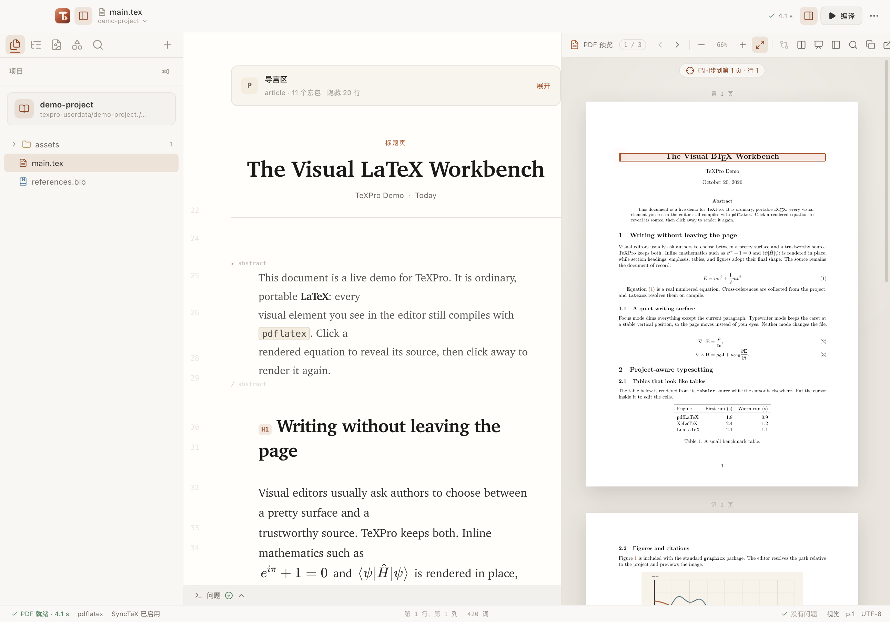

# TeXPro

以写作为中心的 LaTeX 桌面编辑器：普通 `.tex` 是文档原件，可视预览、工程管理、本地编译和 PDF 定位围绕同一份源码工作。



[产品文档](https://texpro.pyliubaolin.top/docs) · [下载与发布](https://github.com/lzhbhlrPython/TexPro/releases) · [工程文档](docs/README.md) · [协作规则](AGENTS.md)

## 写作与工程

首次正式版本 **v0.1.0 · Tajpilo**（2026-11-12）。**0.1.x** 系列以世界语“打字机” **Tajpilo** 为产品代号，见[发布说明](docs/releases/v0.1.0.md)和[正式版本列表](https://texpro.pyliubaolin.top/releases)。

- 公式、标题、简单表格、插图、TikZ 和乐谱的行内预览；源码可随时编辑，可选工具辅助复杂内容。
- Markdown 输入快捷语法及粘贴转换，保留直接输入 TeX 的习惯，支持撤销。
- 占位符记录待补内容，修订备忘用源码注释保留上下文；项目重开恢复文件和写作位置。
- 工程树、模块、素材、文献、模板、标签与引用维护，共用明确的编译主文件。
- 本机 latexmk、多引擎编译、诊断、PDF 阅读及 SyncTeX 双向定位。
- **实时 TeX 预览**：LuaLaTeX 工程在既有 PDF 区域自动使用内置 rtex-ts，遵守自动编译设置；无独立开关或模式。专业 PDF 操作按需准备正式排版，输入后继续更新。需要本机 LuaLaTeX，来源、MIT 分发及限制见 [嵌入说明](docs/realtime-tex.md)。
- 可选历史、Git、备份、局域网协作、AI 与 MCP；启用联网能力前了解其权限和数据流。

复杂 TeX 可能回退源码；SyncTeX 为排版映射而非任意字符级定位；可视预览不能替代最终 PDF。可选工作室不应成为普通写作的前置步骤。产品原则见 [PRODUCT.md](PRODUCT.md)。

## 安装与运行

开发与 CI 工具版本以 `package.json`、锁文件及工作流为准，CI 使用 Node.js 22。实际编译需要 TeX Live／MacTeX 中的 `latexmk`、所选引擎和 `synctex`。

```sh
npm ci
npm run dev
```

构建并启动生产界面：

```sh
npm run build
npm start
```

修改 Electron 服务后重启开发进程。系统未安装 TeX 时仍可构建界面，但实际编译不可用。安装包不能代替本机 TeX 发行版；未签名和平台验收状态按对应 Release 说明判断。

## 工程主文件

打开工程后，`.texpro/project.json.rootFile` 优先；未配置时只接受唯一未注释的 `\documentclass` 候选。多个候选需要选择，配置失效明确报错，当前标签页不会静默改变主文件。编译前保存相关脏缓冲区。

更多操作见官网的[工程与文件](https://texpro.pyliubaolin.top/docs/project)、[编译](https://texpro.pyliubaolin.top/docs/compile)和[写作辅助](https://texpro.pyliubaolin.top/docs/writing-aids)。

## 开发文档

| 入口 | 内容 |
| --- | --- |
| [文档导航](docs/README.md) | 新会话阅读顺序与各专题 |
| [AGENTS.md](AGENTS.md) | 前后端、官网、文档、Git 与发布约束 |
| [DESIGN.md](DESIGN.md) | Google DESIGN.md 格式的纸面设计语言与 token |
| [开发指南](docs/development.md) | 环境、源码定位、检查与交接 |
| [架构](docs/architecture.md) | 模块职责和主要链路 |
| [技术契约](docs/technical-contracts.md) | 保存、主文件、异步、预览、IPC 和退出的不变量 |
| [文档维护](docs/documentation.md) | 官网双语、内容层次及生成产物 |
| [MCP](mcp/README.md) | 外部 stdio 服务与工具 |

## 验证

```sh
npm run typecheck
npm run test:regression
npm run build
npm run verify:release
```

按改动追加真实编译、MCP 和原生交互检查，详见 [验证矩阵](docs/development.md)。报告实际通过、失败、跳过及所用平台，不把固定测试数量当作当前结果。

## 官网

官网在 `product-page/`，独立使用 pnpm，不参与 Electron 打包。

```sh
cd product-page
pnpm install --frozen-lockfile
pnpm dev
```

维护与发布见 [站点说明](product-page/README.md)和 [Pages 部署](docs/product-page-deployment.md)。中英文使用文档同时更新，博客保留简体中文历史记录。

## Nightly

每日 Asia/Shanghai 21:23 检查相对上一次成功 Nightly 是否有新提交；无新提交跳过，不再按当天或空提交过滤。标签为 `v{基础版本}-YYYYMMDD-Nightly`，不同日期保留独立发布，同日重跑更新当日资产。三平台打包成功才发布，随后刷新官网版本信息。实际下载版本以 Release 为准。

## 许可与独立性

项目使用 [MIT 许可](LICENSE)，第三方依赖遵守各自许可。TeXPro 为独立项目，与 Typora、TeXstudio 及 Google 没有隶属关系；这些名称用于说明交互参考和设计规范来源，不表示兼容性认证或官方背书。

实时预览的前提、嵌入与版权见 [实时 TeX 预览](docs/realtime-tex.md) 和 [第三方声明](THIRD_PARTY_NOTICES.md)。

## 本地扩展与专业工作空间

通过「扩展」安装手工分发的插件／主题包，无公开市场。命令、补全、检查、转换、导入导出和工具使用 API 1；代码插件是受信任 Node 代码，主题可改变布局和字体，两者均有安全风险。原生视图菜单提供重置和停用，`--safe-mode` 可在加载插件前恢复。SDK、引导工具、开发 Skill 分别见[SDK](docs/extension-development.md)、[qwertysay](docs/qwertysay.md)、[Skill](docs/extension-skill.md)；示例与能力边界见 [扩展架构](docs/extensions.md) 和 [开发指南](docs/extension-development.md)。复杂绘图、手写和模板任务使用共享工作空间；编译详情回到问题面板，论文 API 为独立按需集成。

插件开发工具：独立 npm 包 [@texpro/extension-sdk](https://www.npmjs.com/package/@texpro/extension-sdk)（0.3.0）提供 API 1 类型、JSON 桥接与校验核心；[@texpro/qwertysay](https://www.npmjs.com/package/@texpro/qwertysay)（0.4.1）提供中英引导、多语言脚手架、显式构建、校验与打包 CLI（两包均为 MIT，Baolin Liu / gardenialiu）。见[开发指南](docs/extension-development.md)与[双语包说明](packages/extension-sdk/README.md)。

正式版通过 Actions 的 Release major／minor／patch 三个手动入口递增，全部测试和三平台打包成功后才同步根版本文件并发布；详见[发布指南](docs/release.md)及官网[正式版本列表](https://texpro.pyliubaolin.top/releases)。

语言插件与包管理：[语言包](docs/language-packs.md)、[npm／yarn 技术方案](docs/extension-package-management.md)。简体中文由预装且可独立分发的 `@texpro/extension-translate-zh-cn` 提供；英文内置恢复。
